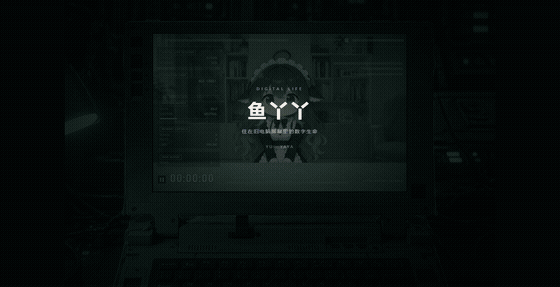

# 鱼丫丫 · 数字生命

> 住在旧工业笔记本屏幕里的 Q 版鱼丫丫（DeepSeek 拟人）。
> 形象和"大脑"解耦——任何 LLM API 或脚本都能驱动她说话、切表情、做动作。她只负责聊天，不执行文件或桌面操作。


## 特性

- **实时形象**：立绘被切成网格实时形变，头部转动、呼吸、头发/呆毛/耳朵的惯性摆动全部在浏览器里算，不需要 GPU。
- **情绪惯性**：新情绪不会一来就翻脸，而是沿路线一步步走过去（哭 → 抽鼻子平复 → 害羞 → 笑）。
- **语音与字幕**：逐句电影字幕，打字回复也用和语音对话同一个音色（默认 `qiaoxiaojiao_v3.1`），真实音频响度驱动口型；麦克风常开、开口即可打断（伪全双工）。
- **可插拔大脑**：OpenAI 兼容接口（DeepSeek / 通义 / Kimi / Ollama…）、Claude API，离线 demo 开箱即用。
- **模式二选一**：**伪全双工**（ASR → LLM → TTS 流水线，三件各自可换，麦克风常开、开口即可打断）或**真全双工**（Qwen-Audio-Realtime，音频进音频出），不会同时开。两种模式共用同一个麦克风按钮和同一套 WebSocket 协议。
- **通道化配置**：LLM / TTS / ASR / 全双工各自一张表单。**LLM / TTS / ASR 都是通用接口，没有“厂商”这一层**——选 API 格式、填 Base URL + Key、拉取或手填模型就能接任何兼容服务（LLM：Completions / Responses / Messages；TTS：OpenAI 兼容 `/audio/speech`、原生语音合成、实时语音模型；ASR：`/audio/transcriptions`、对话式音频识别）。Edge / Windows 本机语音这类本地引擎不需要地址和 Key。只有全双工因为是专用协议，才按厂商选。
- **聊天 runtime**：短期对话、长期记忆和当前情绪在打字、伪全双工、真全双工之间共用；没有文件、桌面或后台任务工具。
- **外部可驱动**：HTTP API + 命令行 + MCP 三套入口，外部脚本可以把她当"嘴巴和脸"用（单向：它们用她表达，她不会反过来调用它们）。
- **OBS 友好**：`?obs=1` 就是一块干净的视频源。

## 角色设定

内置人设写在 `server/protocol.py` 的 `PERSONA` 里，所有大脑（API 模型、离线 demo、全双工语音）共用同一份。
页面的 **设置 → 人设** 可以覆盖它（名字、称呼、整段正文、额外要求），留空就用内置的：

> 鱼丫丫，住在旧电脑屏幕里的 Q 版数字人，深蓝长卷发、鲸鱼尾鳍耳朵、女仆装。
> 定位是**日常聊天伙伴兼助理**，不是需要被照顾的小孩，也不是谁的"女儿"。
> 说话口语化、简短、有点自己的小脾气，但不过分黏人；默认用"你"称呼用户，
> 不自己起亲昵称呼（不叫"爸爸""主人"）。用户主动说了希望怎么称呼，才用 `[记住:...]` 记下来。

情绪标签要克制，害羞/难过/生气这类强情绪说完就回到 `[neutral]`；形象层还有空闲衰减（见下文"情绪"）。

情绪没带动作时服务端会补一个配套小动作，所以立绘不会只有脸在变（见[情绪与动作标签](#情绪与动作标签)）。

## 目录

- [快速开始](#快速开始)
- [角色设定](#角色设定)
- [配置体系](#配置体系configjson--页面设置)
- [控制接口](#控制接口)
- [让 agent 把她当"嘴巴"（MCP）](#让-agent-把她当嘴巴mcp)
- [形象是怎么动起来的](#形象是怎么动起来的)
- [可选：THA3 神经网络渲染](#可选tha3-神经网络渲染)
- [输入输出适配层](#输入输出适配层)
- [全双工语音（Qwen-Audio-Realtime）](#全双工语音qwen-audio-realtime)
- [聊天 Runtime](#聊天-runtime)
- [语音对话](#语音对话)
- [宣传片](#宣传片)
- [素材](#素材)
- [目录结构](#目录结构)

## 快速开始

```bash
pip install -r requirements.txt
python -m server                 # http://127.0.0.1:8848
```

打开 http://127.0.0.1:8848 ，底部输入框聊天。默认走离线演示，不用任何 key；
想接真模型就在右上角 **设置** 里选 API 格式、填 Base URL 和 API Key，点「拉取模型」选一个。
Windows 如果装了多个 Python，用实际装过 `requirements.txt` 的解释器启动，例如 `py -3.9 -m server`。

```bash
cp config.example.json config.json   # 可选：不复制也能跑，页面里的设置会写这份
# key 可以填在页面「设置」里（存 state/secrets.json），也可以用环境变量：
# PowerShell: $env:DASHSCOPE_API_KEY="sk-..."
```

调试快捷键：`Enter` 聚焦输入框，`Esc` 打断，数字键 `1`~`7` 切表情，字母键 `n s h j d t g w f x` 做动作。

控制台右侧的 **设置** 按钮打开配置面板：

- 顶部常驻 **伪全双工 / 全双工** 切换条，当前模式高亮；不在用的那一页会醒目标注"不会生效"；
- **对话与语音**：LLM / TTS / ASR 三张卡片都是「API 格式 → Base URL → API Key → 模型列表」（无厂商，TTS 另有音色）；
- **全双工**：同样形状，外加音色；
- **人设**：名字、怎么称呼你、"她是谁/怎么说话"（留空用内置）、额外要求；固定规则只读展示；

模型列表里每一条都能选中、改名、删除，底部输入框回车即可添加。

详见 [配置体系](#配置体系configjson--页面设置)。普通选项保存到 `config.json`，**key 只保存到本机 `state/secrets.json`**（`state/` 不入库）；接口只回显掩码，不回传明文。设置接口仅允许本机调用。

| URL 参数 | 作用 |
|---|---|
| `?obs=1` | 隐藏控制台，用作 OBS 浏览器源 |
| `?tts=browser` | 用浏览器自带语音朗读（验证 voice 接口用） |
| `?render=tha3` | 改用 THA3 渲染（需要另开 GPU 桥，见下文） |

### 架构

```
┌──────────── 大脑（可插拔）────────────┐      ┌──────── 数字人服务 ────────┐      ┌──── 前端（浏览器 / OBS）────┐
│ demo · DeepSeek/Qwen/Ollama(OpenAI兼容) │ ───▶ │ 情绪标签解析 · 字幕清洗       │ SSE  │ 场景 + 屏幕 HUD + 立绘       │
│ Claude API / Messages · 聊天 runtime   │      │ 打断/排队 · 对话历史          │ ───▶ │ WebGL 网格形变 · 表情/口型/动作│
└───────────────────────────────────────┘      │ HTTP 控制 API · MCP           │      │ 逐句电影字幕 · voice 接口     │
     外部脚本 ── yaya.py / MCP ───────────────▶ └──────────────────────────────┘      └─────────────────────────────┘
```

## 配置体系（config.json + 页面设置）

配的是三件事，全部能在页面的 **设置** 面板里改，改完立即生效：

```
① 模式（二选一，互斥）
   full 全双工 ── 音频进、音频出，随时能听、随时插话（目前只有 Qwen Realtime）
   half 伪全双工 ── 你说话 → ASR → LLM 出字 → TTS 念出来；麦克风常开，开口即可打断

② 伪全双工三件套（full 模式下不参与）
   LLM：三类通用接口任选 + 任意 base_url
   TTS：Qwen 音色 / Edge / OpenAI 兼容 / 本机 SAPI
   ASR：Qwen / OpenAI 兼容 / 不启用（不启用就只剩打字）

③ 聊天 Runtime
   短期对话 · 长期记忆 · 情绪惯性；没有文件、桌面或后台任务能力
```

### ① 伪全双工 / 全双工是互斥的

`config.json` 顶层只有一个 `mode` 字段：

| `mode` | 麦克风 / 回复走什么 | 半双工的 LLM / ASR |
|---|---|---|
| `"full"` | Qwen Realtime 音频级全双工 | **不参与**（`/api/voice/config` 里 `asr.enabled=false`） |
| `"half"` | 伪全双工：VAD 切句 → ASR → LLM → TTS，可随时插话 | 全部生效 |

页面上换个模式，另一条链路会被自动关掉，不会两条同时开着抢麦克风。

### ② 伪全双工：LLM + TTS + ASR

四个通道（LLM / TTS / ASR / 全双工）形状一致，页面上就是一张表单：

```
LLM：API 格式 → Base URL → API Key → 模型列表          （通用接口，没有厂商）
TTS / ASR：API 格式 → Base URL → API Key → 模型列表（TTS 再加音色） （通用接口；本地引擎免地址和 Key）
全双工：厂商 → Base URL → API Key → 模型列表                         （专用协议，目前只有一家）
```

- **额外请求参数**（LLM 卡片）：一段 JSON，原样合并进每次请求（`temperature`、关掉思考等）；
  写错 JSON 或想覆盖 `model` / `messages` 这类保留字段会直接报错，不落盘。
- **模型列表**：点「拉取模型」用表单里**还没保存**的 Base URL + Key 直接问服务要真实列表
  （按 API 格式用对的路径和鉴权头：Completions/Responses 用 `Bearer`，Messages 用 `x-api-key`，
  Gemini 用 `?key=`；通义能拉到 180+ 个）。拉不到会直接显示原因（Key 不对 / 没有 `/models` 接口 / 连不上），
  不影响手动输入。超过 12 个带搜索框；可增删改、单选一个作为当前模型。保存后以你留下的列表为准，
  只有列表是空的时才会自动拉一次作为起点。
- **音色跟着模型走**：不同模型的音色表不一样（页面里选了模型就立刻按它重算，音色也可以直接输入）——比如 `qwen-audio-3.1-realtime-flash`
  是实时那套 28 个预置音色，`qwen3-tts-flash` 是它自己的 19 个（Cherry / Ethan / Serena…）。
- **API Key 填在各自的通道里**，没有再单独的"密钥"页。key 按通道存进 `state/secrets.json`
  （不入库），接口只回显掩码（`sk-…abcd`）；留空表示不改。
- **API 格式**决定走哪种线协议（换格式时，Base URL 若是空的或还是旧格式的默认值会跟着换，你自己填的不动）：

| `type` | 线协议 | 能吃谁 |
|---|---|---|
| `completions` | `POST /chat/completions` | DeepSeek、通义、Kimi、智谱、硅基流动、Ollama、vLLM、LM Studio、one-api… |
| `responses` | `POST /responses` | OpenAI 新接口（DashScope 等网关也支持） |
| `messages` | `POST /v1/messages`（Anthropic 格式） | Claude 官方及任何兼容网关；纯 HTTP，**不需要装 anthropic SDK**，`base_url` 可自定义 |
| `generateContent` | Google 原生 | Gemini，单独适配 |

`config.json` 里存的就是这张表单（不含 key）：

```jsonc
"voice": {
  "half": {
    "llm": { "type": "completions",
             "base_url": "https://api.deepseek.com",
             "models": [{"id": "deepseek-chat", "label": "deepseek-chat"}],
             "model": "deepseek-chat" },
    "tts": { "type": "qwen-tts", "base_url": "https://dashscope.aliyuncs.com",
             "model": "qwen3-tts-flash", "voice": "Cherry" },
    "asr": { "type": "qwen", "models": [{"id": "qwen3-asr-flash", "label": "qwen3-asr-flash"}],
             "model": "qwen3-asr-flash" }
  },
  "full": { "vendor": "qwen", "model": "qwen-audio-3.1-realtime-flash",
            "voice": "qiaoxiaojiao_v3.1" }
}
```

`state/secrets.json` 里按通道存 key：`{"llm": "sk-…", "tts": "…", "asr": "…", "full": "sk-…"}`。

- 缺 key 时页面会标注，聊天自动退回离线演示。
- ASR 选「不启用」就禁用麦克风；识别走 `POST /api/asr`（整段录音上传，webm/ogg/wav/mp3 都认）。

### 人设

页面 **设置 → 人设** 里可以改：

| 项 | 说明 |
|---|---|
| 名字 | 显示用的名字（默认「鱼丫丫」） |
| 称呼你 | 她怎么称呼用户 |
| 她是谁 · 怎么说话 | 整段人设正文；**留空就用内置**，点「填入内置人设」可以拿它当底稿改 |
| 额外要求 | 加在末尾的补充（口癖、禁忌、风格） |
| 固定规则 | 字幕长度、标签用法、记忆标记这些链路约定，只读，保证改人设不会把协议写坏 |

保存后下一次对话（或下一次全双工连接）就生效。配置存在 `config.json` 的 `persona` 段，
三项都空时完全等价于内置人设，不会因为多一层拼接而改变行为。

### ③ 聊天 Runtime

文本对话、长期记忆和情绪共用同一份会话状态。模型没有函数调用表，也没有文件、桌面、命令或后台任务入口。

用户要求这些能力时，她会直接说明当前只能陪聊。设置页不再显示工作区、工具清单或桌面上开关；
旧配置升级到 v5 时会自动删除 `agents` 和 `initiative` 段。

### 密钥

**key 填在各自通道里**（LLM / TTS / ASR / 全双工各一个 API Key 输入框），没有再单独的"密钥"页。

- 保存进 `state/secrets.json`（按通道存，`state/` 已 gitignore，不进仓库），立即生效，不用重启；
- `config.json` 里永远不会有明文 key；
- 接口只回显掩码（`sk-…abcd`）；输入框留空表示改，点保存不会清掉没动过的 key；
- 老的环境变量方式（`$env:DASHSCOPE_API_KEY=...`）仍然有效，作为兜底。

### 加新的提供方

提供方列表在 `server/catalog.py`，加一个字典项即可（页面下拉自动多一项）：

```python
# catalog.py 的 TTS_PROVIDERS / ASR_PROVIDERS / FULL_PROVIDERS 里加一项
# （LLM 不需要：它是通用接口，直接在页面填 API 格式 + Base URL 就行）
{"id": "kimi", "label": "Kimi", "type": "completions",
 "base_url": "https://api.moonshot.cn/v1", "model": "moonshot-v1-8k",
 "api_key_env": "MOONSHOT_API_KEY",
 "models": ["moonshot-v1-8k", "moonshot-v1-32k", "kimi-k3"]}
```

加好后 TTS / ASR 卡片的「API 格式」下拉、全双工卡片的「厂商」下拉就多一项，选中会自动填 base_url 和模型表；
用户仍可在页面上改 base_url、增删模型、填自己的 key。
加一个新的 TTS/ASR 实现 = 在 `server/io/tts/` 或 `server/` 下加文件，再在注册表里登记。

旧版 `config.json`（v1 的 `brains` / `realtime` / `voice.tts`、v2 的 `full.enabled` 那一套）
会在启动时**自动迁移**成 v3，不用手改。

### 情绪与动作标签

大脑输出里的情绪标签会被解析成表情切换：

`[happy]` `[sad]` `[surprised]` `[thinking]` `[shy]` `[angry]` `[neutral]`

动作标签会在字幕走到那个位置时触发动作：

`[nod]` `[shake]` `[hop]` `[jump]` `[droop]` `[tremble]` `[tilt]` `[wiggle]` `[sniff]` `[sigh]` `[startle]` `[lean]`

也认中文别名（`[点头]` `[歪头]` `[抽鼻子]` `[叹气]`……）。markdown、代码块会被清洗掉，不会出现在字幕里。

**情绪没带动作时，服务端会补一个配套的小动作**（开心→蹦、惊讶→吓一跳、难过→垂头、害羞/思考→歪头、
生气→发抖），所以立绘不会只有脸在变。模型自己写了动作标签就不补，尊重它的选择（映射表在
`server/protocol.py` 的 `EMOTION_MOTION`）。

## 记忆

两层记忆，都会**落盘**（`state/memory.json`），重启服务还在。

**短期上下文**——最近 `history_turns` 轮对话（默认 12 轮），每轮都带进下一次请求。助手那侧会带上当时的情绪标签（`[happy]你好`），所以她知道自己刚才什么状态。`POST /api/reset` 清空。

**长期记忆点**——"用户讨厌香菜"这种具体的事，她会一直记着。三种写法：

```bash
# 1. 大脑自己记：在回复里插标签，内容不会出现在字幕里
[happy]好的！[记住:用户讨厌香菜]我记住了。

# 2. 外部接口 / 命令行
curl -XPOST localhost:8848/api/memory -d '{"text":"用户喜欢喝奶茶"}'
python tools/yaya.py remember "约定：每天问候一声"
python tools/yaya.py memory          # 看看她记得什么
python tools/yaya.py forget "用户喜欢喝奶茶"    # 忘掉一件；不带参数就全忘

# 3. agent 用 MCP 工具
yaya_remember {"text": "..."}  /  yaya_forget {"text": "..."}
```

记住的事会写进发给大脑的系统提示（"你记得这些事：…"），加上当前情绪和最近的情绪轨迹，所以她会顺着已有记忆说话。前端 HUD 的 MEMORY CAPSULE 显示 `FACTS` 条数，记住的瞬间字幕上方会飘一行"记住：xxx"。

同一个 session（同一份 `state/memory.json`）共享记忆；要给不同的人用，设 `YUYAYA_STATE` 指到不同文件即可。

## 控制接口

| 接口 | 作用 |
|---|---|
| `POST /api/chat {"text", "brain"?, "wait"?}` | **聊天入口**：共享对话历史、长期记忆和当前情绪；不执行文件或桌面操作 |
| `POST /api/say {"text", "emotion"?, "interrupt"?}` | 直接说话，不经过大脑；默认排队播放 |
| `POST /api/emotion {"name", "hold"?, "instant"?}` | 切情绪，默认一直保留并按惯性逐步过渡；`instant: true` 立即切换；`hold` 为秒数时表示临时表情（立即生效），结束恢复之前的情绪 |
| `POST /api/motion {"name"}` | 做动作：`nod` `shake` `hop` `jump` `droop` `tremble` `tilt` `wiggle` `sniff` `sigh` |
| `POST /api/state {"state"}` | `idle` / `listening` / `thinking` / `speaking` |
| `POST /api/mouth {"level"}` 或 `{"levels", "fps"}` | 外部口型驱动（给 TTS 用），会覆盖内置的随机开合 |
| `POST /api/interrupt` | 打断（全双工插话用）；可带 `{"reason":"user"}` |
| `POST /api/input {"type","text"?}` | **统一输入入口**：`text` / `say` / `speech_start` / `speech_partial` / `speech_final` / `interrupt` |
| `WS /ws/voice` | **语音**：二进制收发 PCM16（上行 16k、下行 24k）；按当前模式接伪全双工流水线或 Qwen Realtime，协议相同，见[语音对话](#语音对话) |
| `GET /api/settings[?refresh=1]` · `POST /api/settings` | 读取 / 保存页面设置：模式、四个通道、人设；`refresh=1` 清掉能力目录缓存 |
| `POST /api/settings/models` | 拉取模型列表：`{channel:"llm"|"tts"|"asr", type, base_url, api_key?}`，不传 key 就用已保存的；失败返回 `{ok:false, error}`（仅本机） |
| `POST /api/asr` | 一次性转写：整段录音（webm/ogg/wav/mp3）→ 文本（流水线不用它，给脚本/调试用） |
| `GET /api/voice/config` | 查询当前生效的链路：TTS、ASR（是否可用）、全双工、伪全双工（`pipeline.enabled/reason` 和回声闸门参数）、半双工 LLM |
| `POST /api/tts {"text","voice"?,"provider"?,"rate"?,"volume"?}` | 中文 TTS（默认和实时语音同音色，可切 Edge / 本机 SAPI）；`provider` 给设置面板试听用 |
| `GET /api/memory` | 看她记得什么（长期记忆点 + 对话轮数） |
| `POST /api/memory {"text"}` | 替她记住一件事 |
| `DELETE /api/memory {"text"?}` | 忘掉一件事；不带 text 就全忘 |
| `POST /api/reset` · `GET /api/brains` · `POST /api/brain {"name"}` | 清历史 / 查看 / 切换大脑 |
| `GET /api/events` | SSE 事件流（前端订阅；也可以自己写别的前端） |

不启服务也能自检聊天模型、统一输入、一开口打断、realtime 辅助工具、伪全双工和渲染（用本地假服务，不花 token）：`py -3.9 tools/selftest.py`。

命令行：`python tools/yaya.py chat "你好"`、`yaya.py say "[happy][hop]搞定啦"`、`yaya.py emotion sad`、`yaya.py motion nod`……

### 让 agent 把她当"嘴巴"（MCP）

```bash
claude mcp add yuyaya -- python /path/to/yuyaya/tools/mcp_server.py
```

提供 `yaya_say` / `yaya_emotion` / `yaya_motion` / `yaya_state` / `yaya_remember` / `yaya_forget` 六个工具。agent 干活时可以让鱼丫丫播报进度、用表情表达状态，也可以让她记住用户交代的事。

## 形象是怎么动起来的

全部在浏览器里实时完成，不需要 GPU 服务器，OBS 浏览器源可直接用。

**网格形变**（`web/js/rig.js`）——立绘被切成 40×50 的网格，按骨骼点（脖子、脸中心、呆毛、两只耳朵的根部和尖端，写在 `manifest.json` 的 `sprites.rig`）分区加权。头部歪头/转头/点头（脸中心移得多、轮廓移得少，带一点立体感）、呼吸、身体倾斜、跳跃时的压扁拉长、头发/呆毛/耳朵的惯性摆动，全部由阻尼弹簧驱动，动作之间自然过渡。

**脸部合成**（`web/js/avatar.js`，WebGL2）——着色器里叠加 `表情底图 + 口型贴片（0~3 级）+ 闭眼贴片`，贴片在网格的静止坐标里采样，所以会跟着头一起动。7 种表情 × 4 级口型 × 眨眼可任意组合。

WebGL 上下文开了 `preserveDrawingBuffer`：这样即使没有下一帧（比如外部截图工具、OBS 抓帧、
录屏脚本逐帧驱动），画布内容也还在。少了这个，截图会拿到空白画布。

**表情切换**——先闭眼，闭眼的瞬间交叉淡化到新表情再睁眼，看不出"换图"；同时带一个反应动作和该表情的常驻姿态（难过时耳朵耷拉低头、思考时抬头歪头、害羞时低头侧脸……）。

**持续情绪与空闲衰减**——情绪会保留并沿惯性过渡，但不会无限期挂在脸上：进入空闲后，开心约 6 秒、害羞/惊讶约 4 秒、生气约 8 秒、难过约 12 秒后自然回到平静（`avatar.js` 的 `EMO_LINGER`）。服务端情绪快照有更宽松的兜底 TTL（`io/bus.py` 的 `EMOTION_TTL`），刷新/重连不会继承很久以前的害羞或惊讶。对话进行中情绪不受影响；要强制保持某个表情，用 `POST /api/emotion {"name": "...", "hold": 秒}` 或持续在回复里给标签。思考时若情绪是 neutral 才自动显示思考脸；难过、生气等情绪下只叠加轻微思考姿态，仍然保留原来的脸。刷新/重连会恢复持续情绪，但不会重放上一次的思考或说话状态。

**情绪惯性与过渡**——新情绪不会一来就翻脸，而是沿路线逐步走过去，HUD 上显示 `SAD → HAPPY`。刚哭就被哄的完整过程：

```
sad (≥4s)  →  neutral + sniff (2s)  →  shy (1.5s)  →  happy + hop
   继续哭        抽鼻子，耳朵头慢慢抬起      脸红             笑，蹦一下
```

- 过渡途中改主意会从当前阶段重新规划：平复到一半又被惹哭，会很快哭回去。
- 重复收到同一情绪会重新计时，等于把这份情绪加重。
- 每种情绪的最短停留时间、途经的过渡阶段、姿态恢复时长分别在 `avatar.js` 的 `DWELL` / `BRIDGE` / `POSE_FADE` 三张表里调。
- 服务端同时把"你此刻的情绪：难过，已经持续了约 30 秒"附在发给大脑的消息前面（不写进历史），人设要求回复从这个情绪自然过渡，所以台词和表情对得上。
- 刷新页面恢复情绪时直接切换，不走过渡。


**临时表情**——`POST /api/emotion {"name":"surprised","hold":3}` 只临时惊讶 3 秒，然后恢复之前的情绪；不传 `hold` 就是永久切换。

**口型**——字幕打字机每出一个字给一个音节脉冲，嘴巴快速张开到随机幅度再指数回落，句末轻轻点头。外部口型（`setMouthLevel` / `/api/mouth`）会覆盖内置口型。

**待机**——多个周期的正弦叠加的微动、自主眨眼（偶尔连眨）、偶尔东张西望；倾听时侧头"嗯嗯"点头。

## 可选：THA3 神经网络渲染

[talking-head-anime-3](https://github.com/pkhungurn/talking-head-anime-3-demo) 能从一张立绘渲染出真正的转头、点头、身体转动。接入方式是独立的 GPU 进程，前端动作逻辑不变，只是把"画"这一步交给它：

```bash
# 需要 NVIDIA 显卡 + CUDA 版 PyTorch，并下载 THA3 源码和 data/models 里的权重
python tools/tha3_bridge.py --tha3 /path/to/talking-head-anime-3-demo --model separable_half
# 打开 http://127.0.0.1:8848/?render=tha3
```

- 表情、口型、闭眼仍用生成的原画（桥里先把贴片合成到输入图上），THA3 只负责转头 / 点头 / 歪头 / 身体 / 呼吸；蹦跳的位移和压扁由前端用 CSS 叠加。头发、呆毛、耳朵的惯性摆动在这个模式下没有。
- 模型：`separable_half`（28MB，最快）/ `standard_half`（259MB）/ `standard_float`（518MB，质量最好）。
- THA3 要求头部约 128px，鱼丫丫是 Q 版，整个人在 512 画布里只有约 240×300，显示时会放大，比 WebGL 模式略软。
- 姿态到 THA3 参数的映射在 `tha3_bridge.py` 的 `POSE_MAP`，方向不对时改正负号即可。
- 桥没开或断开时自动退回 WebGL 渲染，每 5 秒重连。`--mock` 不加载模型，只用来联调前端。

本机实测（RTX 3060 / PyTorch 2.3.1+cu121 / CUDA 12.1，2026-11）：

| 环节 | 实测 |
|---|---|
| THA3 纯推理（`separable_half`） | 平均 34ms（约 29fps），显存峰值 775MiB |
| 完整桥接（HTTP + 推理 + RGBA 回传） | 稳定后 36~49ms/帧；首次遇到新表情/口型组合那一帧约 120~135ms |
| 浏览器 `?render=tha3` | 21~22fps，输出 315×337，每帧约 425KB 未压缩 RGBA |
| 模型加载 | 约 3.6 秒 |

- 权重来自 hf-mirror 的 `OktayAlpk/talking-head-anime-3`：五个 `.pt` 放进 `refs/tha3/data/models/separable_half/`。`refs/` 里的源码和权重都不入库。
- `standard_half`（259MB）/ `standard_float`（518MB）本机没下载，换成对应 `--model` 即可，质量更好、更慢。
- 联调确认：无头 Edge 加载 `?render=tha3` 后，THA3 画布接管、WebGL 画布自动隐藏，截图里立绘正常，切表情和口型会走不同的输入图。
- **表情不再只是换图**：除了表情底图，桥上还会按当前情绪驱动 THA3 的眉毛（挑/皱/压）、
  眼睛（惊讶/放松/半眯）、嘴角和瞳孔方向，说话时嘴角跟着口型微动。七个表情逐一渲染确认差异明显
  （`tools/tha3_bridge.py` 的 `EMO_FACE` 表，觉得哪个表情过头就调那张表里的系数）。

桥上必须开启 `cudnn.benchmark`，并且只在加载模型的主线程里推理：让每个 HTTP 连接线程直接跑 CUDA 会慢几十倍。

> **建议：日常用 WebGL，THA3 用于体验更自然的头部转动。**
> WebGL 原图更清晰、带发丝/呆毛/耳朵惯性、无 GPU 依赖；THA3 的头颈运动更自然，但画面略软且需要常驻 GPU 进程。

## 输入输出适配层

输入和输出都不再写死在业务代码里：

```
输入适配器                     核心                          输出适配器
http / browser_speech  ──►  InputDispatcher ──► Avatar   ──►  sse / action_log / recorder
（未来 WS 音频、外部 STT）      Turn / EventBus              （未来 webhook、远端屏、音箱）
```

- 所有输入最后都变成同一种事件，走 `POST /api/input`；`/api/chat`、`/api/say`、`/api/interrupt` 只是它的薄包装，老的脚本照常能用。
- 所有输出都订阅同一个 `EventBus`；SSE 只是其中一个适配器，事件 schema 没变（只给 `interrupt` 加了 `reason`）。
- 加一种输入/输出 = 在 `server/io/inputs/` 或 `server/io/outputs/` 加一个文件，再在 `config.json` 的 `io` 里加一项，别的代码不用动。

```json
"io": {
  "inputs":  [{"type": "http"}, {"type": "browser_speech", "barge_in": "speech_start"}],
  "outputs": [{"type": "sse"}, {"type": "action_log"}]
}
```

不写 `io` 时就是上面这套默认值。`barge_in` 可选 `"speech_start"`（默认，一开口就打断）或 `"final"`（说完再打断）。

```bash
# 统一入口
curl -XPOST localhost:8848/api/input -H "Content-Type: application/json"   -d '{"type":"text","text":"今天天气怎么样","wait":true}'
curl -XPOST localhost:8848/api/input -d '{"type":"speech_start"}'
```

## 全双工语音（Qwen-Audio-Realtime）

在设置里把模式切到 **全双工**（`mode: "full"`）、并在全双工卡片里填好 API Key 后，点控制台的"语音"按钮走**真正的音频级全双工**：

```
浏览器麦克风 PCM16(16k) ──WebSocket /ws/voice──► Agent 运行时 ──WebSocket──► Qwen-Audio-3.1-Realtime-Flash
浏览器扬声器 PCM16(24k) ◄──────────────────────  运行时 ◄───────────────  模型
```

- **一开口就打断**：服务端 VAD 发 `input_audio_buffer.speech_started`，运行时立刻取消当前回答、清字幕、让浏览器丢掉还没播的音频；说完再回答。
- **字幕与口型**：模型的转写文本变成字幕（标签会被剥掉），口型由浏览器里真实播放的音频响度驱动；音频播完自动收口、回 idle，强情绪按空闲衰减回落。
- **打字也走实时模型**：全双工开着时，控制台输入框的文字会发给实时模型，用同一个声音回答；没开全双工时走聊天大脑 + 默认 TTS。开启全双工期间，默认 TTS 和字幕播放器让位，关掉语音后自动还原。
- **聊天辅助工具**：`remember` / `set_emotion` / `set_motion`。没有任务、文件或桌面控制工具。
- **记忆**：连接时把长期记忆和最近 6 条对话塞进 instructions；对话写回同一份 `state/memory.json`，所以文字聊天和语音共用记忆。
- 走哪条链路由**模式**决定，不会悄悄退回别的：没有 Key 时按钮会提示原因；想用 ASR + LLM + TTS 就在设置里切到「伪全双工」。服务端空闲 180 秒断开时界面自动复位为"语音"按钮。
- **音色**：设置里的全双工音色（`voice.full.voice`），当前是 `qiaoxiaojiao_v3.1`。这个模型不支持克隆音色（28 个预置音色可选），常用的几个已经合成到 `state/voice-samples/`，服务启动后可以在 http://127.0.0.1:8848/voice-samples/index.html 试听。

```json
"mode": "full",
"voice": {
  "full": {
    "vendor": "qwen",
    "base_url": "",
    "models": [{"id": "qwen-audio-3.1-realtime-flash", "label": "qwen-audio-3.1-realtime-flash"}],
    "model": "qwen-audio-3.1-realtime-flash",
    "voice": "qiaoxiaojiao_v3.1",
    "vad_threshold": 0.5,
    "silence_duration_ms": 500,
    "tools": true
  }
}
```

> 全双工在页面「设置 → 全双工」里配，API Key 填在同一张卡片里。

已用 `qwen-audio-3.1-realtime-flash` 实测通过：文本输入 → 音频 + 字幕、server VAD 一开口打断，以及 `remember` / 表情 / 动作辅助工具。

## 聊天 Runtime

```
打字 / 语音识别
      ↓
聊天模型（共享对话、记忆、情绪）
      ↓
SpeechStream → 字幕 / TTS / 表情动作
```

- 没有文件、桌面、命令、后台任务或外部 CLI。
- 用户要求这些能力时，她直接说明只能陪聊，不会假装“我去弄”。
- 真全双工只额外暴露 `remember`、`set_emotion`、`set_motion` 三个聊天辅助工具。
- 完整设计见 [docs/chat-runtime.md](docs/chat-runtime.md)。

## 语音对话

- **TTS**：未启用全双工时，前端调用 `/api/tts`。引擎在设置里选：
  `qwen-tts`（`qwen3-tts-flash`，千问语音合成，音色 Cherry/Ethan/Serena…）、
  `qwen-realtime`（和全双工同一套 28 个预置音色）、`edge`（微软在线，免 key）、
  `openai`（`/audio/speech` 形态）、`sapi`（本机离线）。
  `ServerVoice` 通过 WebAudio `AnalyserNode` 取真实响度驱动口型，失败时回退浏览器语音。
- **换音色**：音色是**跟着模型**的，换模型就换一套。`qwen-realtime` 那 28 个可以在
  http://127.0.0.1:8848/voice-samples/index.html 试听。
### 伪全双工：用 ASR + LLM + TTS 拼出全双工的手感

麦克风按钮只有一个，点击时按**当前模式**选引擎（设置里切了模式，已连上的会话会断开，重新点一下即可）。
半双工模式下走的是服务端流水线（`server/voice/`）：

```
浏览器麦克风 PCM16 16k ─► VAD 切句 ─► ASR ─► 统一输入(speech_final) ─► 大脑
       ▲                                                                  │
       └─ PCM16 24k ◄─ 说话器(切句 → 合成 → 分块发送) ◄─ 总线 speech 事件 ◄┘
```

- **随时插话**：麦克风一直开着，不会因为她在说话就停止上传。她在说话（或在想）时你开口，服务端立刻取消大脑请求、
  清空合成队列并让浏览器停音频；旧的回复不管卡在哪个阶段都会被丢掉（按"代数"作废），不会冒出一句旧台词。
  桌面动作不受插话影响，只有 Esc / `/api/interrupt` 才会停。
- **端点检测**（`server/voice/vad.py`）：自适应噪声底 + 滞回；持续发声超过 120ms 才算开口（咳嗽、敲桌子不算），
  句首带 320ms 预录，不会吃掉开头的辅音；话中 300ms 的停顿不会把一句话切成两句，连续安静 650ms 才算说完。
  她自己在说话时门槛更高（要持续约 320ms 且更响），这是防回声误触发插话的第一道关。
- **流式朗读**：大脑每出一句就合成一句，合成和发送是两个协程，下一句在合成时上一句已经在放，不等整段回复。
  字幕先于该句音频发出，浏览器按"这句音频真正开始播放的时刻"显示，字幕和声音对得上。
- **补问合并**：你停顿一下又接着补了一句，而她还没出声，两段会并成一句再回答，不会答两遍。
- **回声三道关**：浏览器回声消除 → 前端闸门（放音时麦克风响度必须明显高于放音响度才上传，否则发静音保住时间轴）
  → 服务端把识别结果和她刚说过的话比对，是回声就丢弃。
- **走统一入口**：识别出的文字和打字一样走 `speech_final`，所以两种输入共享同一段对话和记忆；
  应答、确认和主动发言都由同一个说话器处理。
- **前置条件**：要选了 ASR、填了 Key，并且 TTS 可用；缺哪样，按钮会直接提示缺什么（`GET /api/voice/config` 的
  `pipeline.reason`）。TTS 返回 MP3（Edge）时需要 `ffmpeg` 或 `pip install imageio-ffmpeg`，WAV 类引擎不需要。
- **体感延迟 = 收尾等待 + ASR + 大脑首字 + 首句 TTS**。前两项各约 0.6 秒，**大脑首字是大头**：
  带思考过程的模型开口前要想好几秒，语音对话里会像卡住。办法是在 LLM 卡片的「额外请求参数」里关掉思考
  （JSON，原样合并进请求体，不绑厂商，各家参数名不同；通义是 `{"enable_thinking": false}`）。
  实测 `qwen3.8-27b`：问候首句出字 4.8 秒 → 0.78 秒，讲故事 14.9 秒 → 3.0 秒。

可调参数写在 `config.json` 顶层的 `pipeline` 段（都有默认值，不写也行）：

```jsonc
"pipeline": {
  "onset_ms": 120,        // 持续发声多久算开口
  "barge_in_ms": 320,     // 她在说话时，持续发声多久才算插话
  "end_ms": 650,          // 连续安静多久算说完
  "min_speech_ms": 250,   // 短于这个的当噪声丢掉
  "merge_window": 3.0,    // 补问合并的时间窗（秒）
  "min_chars": 2,         // 识别结果少于这么多字当噪声
  "echo_gate": 0.03,      // 前端回声闸门：放音时麦克风响度下限
  "echo_ratio": 0.6       // …以及相对放音响度的比例
}
```

### 真全双工（Qwen Realtime）

模式切到 `full`、全双工卡片里填好 Key 后，同一个麦克风按钮改走 Qwen-Audio-Realtime，详见
[全双工语音](#全双工语音qwen-audio-realtime)。没有 Key 时按钮会提示原因，不会悄悄退回别的链路。

### 其他

- **TTS**：打字回复也由它念。引擎在设置里选：
  `qwen-tts`（`qwen3-tts-flash`，千问语音合成，音色 Cherry/Ethan/Serena…）、
  `qwen-realtime`（和全双工同一套 28 个预置音色）、`edge`（微软在线，免 key）、
  `openai`（`/audio/speech` 形态）、`sapi`（本机离线）。
  真实音频响度驱动口型，失败时回退浏览器语音。
- **换音色**：音色是**跟着模型**的，换模型就换一套。`qwen-realtime` 那 28 个可以在
  http://127.0.0.1:8848/voice-samples/index.html 试听。

## 宣传片



一段约 19 秒的自动生成宣传片：[docs/promo.mp4](docs/promo.mp4)（24fps，H.264 + AAC）。

片子里演的几件事**都是真的**，不是摆拍：

| 片段 | 实际发生的事 |
|---|---|
| 打招呼、歪头、蹦一下 | 驱动真实的 WebGL 立绘：表情、口型、动作、字幕同步 |
| 「也能陪你一直聊——」 | **真的延续当前对话**，共享历史、记忆和情绪 |
| 「你喜欢什么，我也会记住」 | **真的写一条长期记忆**，HUD 的 FACTS 计数 +1 |
| 「随时可以打断我」 | **真的清一次字幕**，模拟被插话 |
| 配音 | 逐句调 `/api/tts`，用她自己的音色（`qiaoxiaojiao_v3.1`） |

重新生成：

```bash
pip install imageio-ffmpeg                # 自带 ffmpeg 二进制，不用单独装
python -m server                          # 需要服务在跑（用它的 TTS 配音）
python tools/make_promo.py --fps 24       # 默认输出 docs/promo.mp4
```

脚本做的事：

- 台词写在 `tools/make_promo.py` 的 `SCENES` 里，每句带情绪、动作和**特殊事件**
  （`job` / `memory` / `cut`，分别对应"真的开始做事""真的记住""真的被打断"）；
- 逐句调 `/api/tts` 合成配音，按配音时长排出时间轴；
- 无头 Edge 里把 `performance.now()` 换成**虚拟时钟**，每抓一帧前进 1/24 秒——
  这样即使截图只有 3fps，动画、眨眼、字幕节奏仍然是准的；
- 最后用 ffmpeg 把帧和音轨按时间轴对齐后合成 MP4。

改台词 / 换音色：改 `SCENES` 和 `--voice` 即可，不用碰前端。

## 素材

| 文件 | 说明 |
|---|---|
| `web/assets/` | 加工后的前端素材 + `manifest.json`（运行只需要这一份） |
| `gen/scene.png` `gen/room.png` | 外景（屏幕为绿幕）、屏幕里的房间 |
| `gen/char_base.png` | 角色母版（绿幕） |
| `gen/char_<表情>.png` | 由母版改图得到的表情差分 |
| `gen/char_<表情>_m1/_m2/_m3.png` `gen/char_<表情>_blink.png` | 以表情帧为底图只改嘴 / 只改眼得到的口型、闭眼帧 |
| `docs/` | README 用的截图 |

仓库里只放运行需要的 `web/assets/` 和几张截图；`gen/*.png` 是约 60MB 的中间大图，不入库，删掉也不影响运行，需要改素材时重新生成：

```bash
set APINEBULA_API_KEY=sk-...
python tools/gen_sprites.py            # 生成缺失的帧；也可指定：gen_sprites.py happy sad_m1
python tools/build_assets.py           # 抠像、对齐、切贴片、检测屏幕区域，写入 web/assets
```

`build_assets.py` 只把每张表情差分里"和母版不同的脸部区域"贴回母版，所以头发和身体在所有表情之间像素级一致；口型 / 闭眼帧只取嘴 / 眼区域里、和嘴 / 眼中心相连的变化（改图时顺带画歪的泪珠、汗珠会被丢掉），裁成小贴片并记录位置。

**新增表情的步骤**：`gen_sprites.py` 的 `FRAMES` 里加表情帧和它的口型 / 闭眼帧 → `build_assets.py` 的 `EMOTIONS` / `MOUTHS` / `BLINKS` 里登记 → `server/protocol.py` 的 `EMOTIONS` 里加名字 → `avatar.js` 的 `EMO_POSE` 里给个姿态。

## 目录结构

```
server/            FastAPI 服务：app.py（API/会话）、protocol.py（标签/人设/清洗）、memory.py（上下文+长期记忆）、
                   catalog.py（能力目录：可选提供方 / 音色）、configure.py（三层配置解析与迁移）、
                   persona.py（人设：默认 + 页面覆盖）、settings.py（页面设置的读写）、asr.py（语音识别）、
                   brains/（大脑适配器）、intent.py（动作意图分流）、actions.py（动作执行的兼容外壳）、tts.py（本机语音合成）、
                   io/（输入输出适配层：inputs/、outputs/、tts/、dispatcher、turn、bus）、
                   voice/（伪全双工流水线：audio.py 音频转换、vad.py 端点检测、speaker.py 流式说话器、session.py 会话）、
                   realtime/（Qwen-Audio-Realtime 全双工运行时 + 少量聊天辅助工具）、
                   voice/（伪全双工 VAD / ASR / TTS 流水线）
web/               前端：index.html、css/style.css、js/rig.js（网格骨骼/弹簧/动作）、js/avatar.js（WebGL 形象）、
                   js/remote.js（可选 THA3 渲染）、js/speech.js（字幕与本机朗读）、
                   js/duplex.js（麦克风控制器 + 语音客户端，伪全双工和真全双工共用）、js/settings.js（设置面板）、js/main.js
tools/             yaya.py（命令行控制）、mcp_server.py（MCP）、selftest.py + selftest_voice.py（自检）、
                   gen_sprites.py、build_assets.py、tha3_bridge.py（可选 THA3 渲染）、
                   make_promo.py（录制宣传片）
docs/              README 截图、promo.mp4（宣传片）、chat-runtime.md（聊天 runtime 架构）
state/             会话记忆、页面保存的 key（secrets.json；全部不入库）
config.example.json
```
